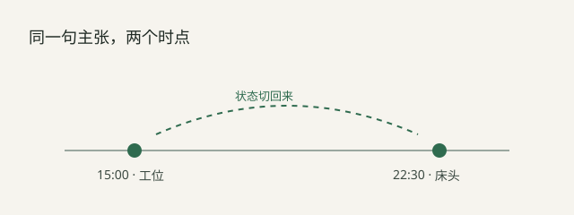

# 一、开场

## 把下午三点和睡前那一刻的状态调回来

### 正文

用一支 150ml 的植物节律液，把下午三点和睡前那一刻的状态调回来。它不是提神饮料，也不是助眠保健品，而是一支按场景切换身体状态的随身补给。

首发只打两个时点：15:00 的工位，与 22:30 的床头。两个时点共用一句主张，只换场景画面。

### 口播

下午三点，你不是困，是状态切不过去。再撑一小时，和现在切回来，是两个问题。

### 制作

- 主画面用真实办公桌与床头两处场景，不拍产品特写堆叠。
- 主标题不超过 12 字，副标题只留「150ml · 15 元」。

> 思路大纲 P05（2026-11-13）。

> 成本与形态：`05-deep-research/reports/01-herbal-food-tech-research.md` 执行摘要（BOM 2.8–3.5 元、15 元零售、毛利 75%–80%）。

# 二、品类与产品

## 新品类叫「植物节律液」，卖的是状态切换

### 正文

定义新品类「植物节律液（Botanical Circadian Elixir）」：以 150ml 浓缩形态锚定「调整状态」，替代褪黑素、旧式运动饮料与日常咖啡。品类核心是调整身心状态，而不是售卖单一孤立功能。

| 使用场景 | 替代对象 | 对应系列 | 交付形态 |
|---|---|---|---|
| 上午与午后 | 咖啡、奶茶 | 焕活 | 150ml 即饮 |
| 运动前后 | 旧式运动饮料、能量饮料 | 运动 | 150ml 即饮 |
| 睡前 | 褪黑素 | 安眠 | 150ml 即饮 |

150ml 与 15 元对应的是状态切换，不是解渴容量。三支系列各自替掉一个更差的选择，读者才能理解为什么同一套定价能覆盖三个场景。

### 口播

我们不是把一瓶饮料做小，是把「一次有效」做成可计量的单位。15 元买的不是 150 毫升，是一次确定的状态切换。

### 制作

- 三列并置，不要做成三张独立产品卡；让替代关系一眼可见。
- 深绿做主色，植物感，不做成药感。

> 品类定义与三系列：`思路大纲.md` P05。

> 替代品与场景：`02-beverage-trends/derived/03-global-breakthrough-concepts-matrix.md`。

> 定价与形态：`05-deep-research/reports/01-herbal-food-tech-research.md` 执行摘要。

# 三、产品与工程

## 用工程链把「有效」做成可交付

### 正文

草本配方要同时解决三件事：有效、好喝、能常温交付。四步工程链分别对应这三件事，缺一步都会在货架上露馅。

| 工程步骤 | 关键参数 | 解决的问题 |
|---|---|---|
| 低温超声提取 | 热敏成分保留 | 有效成分不被高温破坏 |
| 大孔树脂脱苦 + β-环糊精包合 | 脱除约 85% 涩单宁 | 草本不苦、不涩 |
| 微射流粉碎 | 150–200MPa，粒径 10–50nm，浊度低于 3 NTU | 无颗粒感、吸收率提升 3–5 倍 |
| UHT 瞬灭 + 百级冷灌 | 137℃ / 3 秒 | 0 防腐剂、12–18 个月常温保质 |

单瓶 BOM 2.8–3.5 元，15 元零售对应 75%–80% 毛利。这是工程报告的成本推算，不是已经跑通的供应链报价。

### 口播

不讲「科学配方」，讲这四步各自解决了什么。能常温放 12 个月、不加防腐剂，才有资格进精品渠道。

### 制作

- 四步按箭头横向排列，参数只留一行，不堆小字。
- 右下角标明「成本为工程估算，未经询价」，不隐藏边界。

> 提取、脱苦、纳米化与冷灌装参数：`05-deep-research/reports/01-herbal-food-tech-research.md` 议题二、三。

> BOM 与毛利：同上，执行摘要。

> 法规目录：同上，配方章节。

# 四、品牌命名

## 微季候 / MIKORA：与节气同频的掌心微节律

### 正文

微季候 / MIKORA 是三选一的首选推荐：把日常饮升格为与自然节气同频的掌心微节律，支撑 15 元全时段溢价。

「微」锚定 150ml 微剂量与微生态精度，「季候」取二十四节气物候轮转；英文 Mik-ora 轻变形自熟词 Micro 并融希腊时令 -ora。二阶神话把日常饮水升格为「与自然节气同频」：微科学祛掉中医的老气，季候柔化科技的冰冷。

公开全网与开放库均无「微季候」精确重名，mikora.cn 可布局；定稿前仍需排查女装「季候风」跨类，并与「微气候」做区分。

### 口播

它听起来不像药，也不像功能饮料。它像你随身带着的一小段季节。

### 制作

- 标题左对齐，英文名与中文名同排；不放证书与实验室素材。
- 底部保留一行「命名初筛，未完成商标注册」。

> 方案与推荐：`思路大纲.md` P10。

> 命名方法与证据边界：`03-brand-naming/README.md`（只覆盖中文官网）。

> 符号学与神话系统：`05-deep-research/reports/02-semiotics-and-naming-research.md`。
